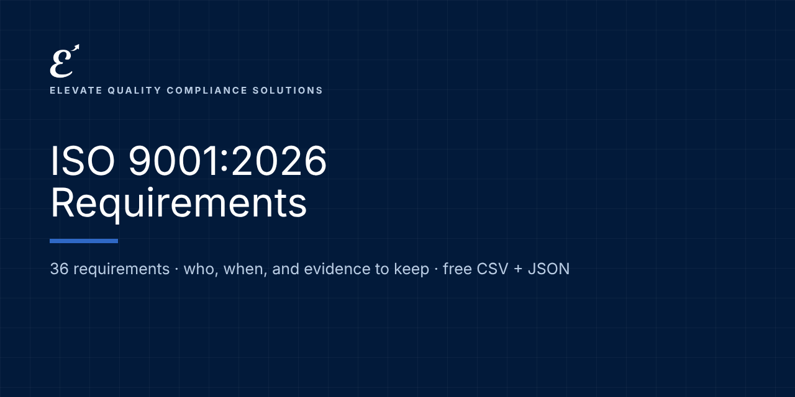

# ISO 9001:2026: Requirements and Evidence

   

**Free, machine-readable ISO 9001:2026 requirements in plain language: who each one applies to, when it applies, and examples of the evidence to keep.** CSV and JSON, ready for Excel, Google Sheets, GRC tools or your own code.

Maintained by [Elevate Quality Compliance Solutions](https://elevateqcs.com). If this saves you time, please ⭐ star the repo so others can find it.

**Source:** ISO 9001:2026 Quality management systems. Clause references with our own plain-language summaries; the standard's text is copyrighted and not reproduced.
**Official text:** https://www.iso.org/search.html?q=9001

## Key dates
| Date | What applies |
|---|---|
| 2026-09-16 | ISO 9001:2026 published |
| Transition | Check your certification body for the transition deadline |

## How to use it (2 minutes)
1. **Browse online:** [https://elevate-qcs.github.io/iso-9001-2026-requirements/](https://elevate-qcs.github.io/iso-9001-2026-requirements/) and search or filter.
2. **Spreadsheet:** download [`data/requirements.csv`](data/requirements.csv), open it in Excel or Google Sheets, and add columns for status, owner and evidence location. That's your gap assessment.
3. **Code and GRC tools:** load [`data/requirements.json`](data/requirements.json) (format: [`schema/`](schema/requirement.schema.json); examples: [`examples/`](examples/)).

Full guide: [docs/HOW-TO-USE.md](docs/HOW-TO-USE.md) · [FAQ](docs/FAQ.md)

## Requirements (36)
Applies to: organization

| Reference | Requirement | Applies to | From | Evidence examples |
|---|---|---|---|---|
| 4.1 | **Understanding the organization and its context**: Know the internal and external issues that affect what your QMS can achieve, including whether climate change is relevant. | organization | Certifiable; transition from ISO 9001:2015 | Context register with issues and review date; climate determination with reasons; review at management review. |
| 4.2 | **Needs and expectations of interested parties**: Identify who has a stake in your QMS, what they require, and which of those requirements your QMS addresses. | organization | Certifiable; transition from ISO 9001:2015 | Interested-party register showing requirements and which are addressed through the QMS. |
| 4.3 | **Scope of the QMS**: Decide and write down what the QMS covers: products, services, sites, and any requirement you treat as not applicable, with reasons. | organization | Certifiable; transition from ISO 9001:2015 | Scope statement (documented information) with justification for any non-applicable requirement. |
| 4.4 | **QMS and its processes**: Define the processes the QMS needs, how they connect, who owns them, and how you control and measure them. | organization | Certifiable; transition from ISO 9001:2015 | Process map and process cards; procedures or instructions needed to run processes; records that processes run as planned. |
| 5.1.1 | **Leadership and commitment**: Top management takes accountability for the QMS and promotes a quality culture and ethical behavior. | organization | Certifiable; transition from ISO 9001:2015 | Management review minutes, culture and ethics statement, concern log, evidence of leaders' involvement. |
| 5.1.2 | **Customer focus**: Leaders make sure customer and legal requirements are understood and met and customer satisfaction stays a priority. | organization | Certifiable; transition from ISO 9001:2015 | Customer satisfaction results and actions; KPI reviews; complaint handling. |
| 5.2 | **Quality policy**: Set a quality policy that fits your context and strategic direction, communicate it, and make it available. | organization | Certifiable; transition from ISO 9001:2015 | Approved policy (documented information), communication records, availability to interested parties. |
| 5.3 | **Roles, responsibilities and authorities**: Assign and communicate who is responsible for what in the QMS, including keeping the QMS intact during change. | organization | Certifiable; transition from ISO 9001:2015 | Role profiles or RACI tables, organization chart, appointment of responsibilities. |
| 6.1.1 | **Determining risks and opportunities**: Use your context and interested parties to identify risks and opportunities the QMS must address. | organization | Certifiable; transition from ISO 9001:2015 | Risk and opportunity registers linked to context issues. |
| 6.1.2 | **Actions to address risks**: Analyze and evaluate risks and take actions proportionate to their impact. | organization | Certifiable; transition from ISO 9001:2015 | Risk register with ratings, actions, owners and effectiveness review. |
| 6.1.3 | **Actions to address opportunities**: Analyze and evaluate opportunities separately and decide which to pursue. | organization | Certifiable; transition from ISO 9001:2015 | Opportunity register with decisions and results. |
| 6.2 | **Quality objectives**: Set measurable objectives at relevant functions and plan what, who, when and how results are evaluated. | organization | Certifiable; transition from ISO 9001:2015 | Objectives with targets, plans and progress (documented information). |
| 6.3 | **Planning of changes**: Plan changes to the QMS in a controlled way: purpose, consequences, resources, communication, and review of results. | organization | Certifiable; transition from ISO 9001:2015 | Change planning records, communication and post-change review. |
| 7.1.1–7.1.4 | **Resources, people, infrastructure, environment**: Provide the people, infrastructure and work environment the processes need. | organization | Certifiable; transition from ISO 9001:2015 | Resource plans in management review; maintenance records; work environment provisions. |
| 7.1.5 | **Monitoring and measuring resources**: Keep measuring equipment suitable, calibrated or verified, identified and protected; act if it is found out of calibration. | organization | Certifiable; transition from ISO 9001:2015 | Calibration register and certificates; basis for calibration where no standard exists; out-of-tolerance assessments. |
| 7.1.6 | **Organizational knowledge**: Identify the knowledge needed to run processes and achieve results, then retain, apply and share it. | organization | Certifiable; transition from ISO 9001:2015 | Knowledge map, lessons learned, key-person risk actions. |
| 7.2 | **Competence**: Define required competence for each role, close gaps through training or other actions, and evaluate effectiveness. | organization | Certifiable; transition from ISO 9001:2015 | Training matrix, qualifications, training records and effectiveness checks (documented evidence). |
| 7.3 | **Awareness**: Make sure people know the policy, objectives, their contribution, quality culture and ethics, and the consequences of not following the QMS. | organization | Certifiable; transition from ISO 9001:2015 | Awareness session records, quiz results, induction records. |
| 7.4 | **Communication**: Decide what, when, with whom and how to communicate internally and externally about the QMS. | organization | Certifiable; transition from ISO 9001:2015 | Communication plan or matrix; meeting records. |
| 7.5 | **Documented information**: Create, approve, update and control documents and records so the right version is available and protected. | organization | Certifiable; transition from ISO 9001:2015 | Document master list, approval and revision records, retention list, access controls. |
| 8.1 | **Operational planning and control**: Plan and control the processes needed to deliver products and services, including outsourced ones. | organization | Certifiable; transition from ISO 9001:2015 | Control plans, work instructions, records that processes were carried out as planned. |
| 8.2 | **Requirements for products and services**: Communicate with customers (including contingency information), determine requirements, review them before committing, and manage changes. | organization | Certifiable; transition from ISO 9001:2015 | Contract or order review records, records of changed requirements, contingency information given to customers. |
| 8.3 | **Design and development**: Plan and control design: inputs, controls, outputs and changes. Not applicable if you do not design. | organization | Certifiable; transition from ISO 9001:2015 | Design plans, input records, reviews, verification and validation, design change records. |
| 8.4 | **Control of externally provided processes, products and services**: Evaluate, select, monitor and re-evaluate suppliers, and tell them your requirements. | organization | Certifiable; transition from ISO 9001:2015 | Supplier evaluations, approved supplier list, performance monitoring, purchase requirements. |
| 8.5.1 | **Control of production and service provision**: Run production or service under controlled conditions: information, equipment, competent people, validation where needed. | organization | Certifiable; transition from ISO 9001:2015 | Work instructions, job records, process validation where output cannot be verified. |
| 8.5.2–8.5.5 | **Identification, traceability, property, preservation, post-delivery**: Identify outputs and their status, trace where required, care for customer property, preserve product and meet post-delivery needs. | organization | Certifiable; transition from ISO 9001:2015 | Traceability records, customer property records, post-delivery activity records. |
| 8.5.6 | **Control of changes**: Review and control unplanned production or service changes and record the results. | organization | Certifiable; transition from ISO 9001:2015 | Change records with review results, who authorized and actions. |
| 8.6 | **Release of products and services**: Verify requirements are met before release and record who authorized it. | organization | Certifiable; transition from ISO 9001:2015 | Release records with conformity evidence and authorizing person. |
| 8.7 | **Control of nonconforming outputs**: Identify and control nonconforming outputs; correct, segregate, inform or accept under concession. | organization | Certifiable; transition from ISO 9001:2015 | NC records: description, actions, concessions, authority for the decision. |
| 9.1.1 | **Monitoring, measurement, analysis and evaluation**: Decide what to monitor, how and when, and evaluate QMS performance and effectiveness. | organization | Certifiable; transition from ISO 9001:2015 | KPI dashboard, analysis results (documented evidence). |
| 9.1.2 | **Customer satisfaction**: Monitor customers' perception of how well their needs are met. | organization | Certifiable; transition from ISO 9001:2015 | Survey results, analysis and actions. |
| 9.1.3 | **Analysis and evaluation**: Analyze data to evaluate conformity, satisfaction, performance, risk actions, suppliers and improvement needs. | organization | Certifiable; transition from ISO 9001:2015 | Analysis reports feeding management review. |
| 9.2 | **Internal audit**: Run a planned audit program with objectives, criteria and scope; report results and act on findings. | organization | Certifiable; transition from ISO 9001:2015 | Audit program, plans with objectives, reports and findings (documented evidence). |
| 9.3 | **Management review**: Top management reviews the QMS at planned intervals with all required inputs and records decisions. | organization | Certifiable; transition from ISO 9001:2015 | Management review minutes covering all inputs and outputs (documented evidence). |
| 10.1 | **Continual improvement**: Use results, analysis and review outputs to improve the QMS and its results. | organization | Certifiable; transition from ISO 9001:2015 | Improvement projects and their results; opportunity register. |
| 10.2 | **Nonconformity and corrective action**: React to nonconformities, find root causes, act, check effectiveness and update risks if needed. | organization | Certifiable; transition from ISO 9001:2015 | Nonconformity and corrective action records with root cause and effectiveness verification. |

## Implementation kit (launching soon)
This repository tells you **what** is required. Our ISO 9001:2026 implementation kit gives you **ready-to-adapt documents** to do it: policies, procedures, forms, workbooks, a Kit Navigator and training, mapped to these requirements.
**[Join the launch list](https://elevateqcs.com/coming-soon)** to be notified.

## Disclaimer
This repository is general information to help you understand and organize work on AI governance frameworks. It is not legal advice and does not guarantee compliance, certification or any regulatory outcome. Requirements are summarized in our own words; always check the official texts and get qualified advice for your situation. ISO and IEC standards are copyrighted: we reference clause numbers with our own summaries and never reproduce their text. Buy the standard from ISO, IEC or your national standards body.

## Corrections and contributions
Spotted an error or a change? [Open a correction](../../issues/new?template=correction.md) with a link to the official source. See [CONTRIBUTING.md](CONTRIBUTING.md).

## Reuse and citation
Free under [CC BY 4.0](LICENSE), including commercially, with credit: *"ISO 9001:2026 Requirements by Elevate Quality Compliance Solutions (elevateqcs.com)"*. See [CITATION.cff](CITATION.cff).

## More open requirements from ElevateQCS
[ISO 14001:2026](https://github.com/elevate-qcs/iso-14001-2026-requirements) · [ISO/IEC 27001:2022](https://github.com/elevate-qcs/iso-27001-2022-requirements) · [NIS2](https://github.com/elevate-qcs/nis2-requirements) · [DORA (Financial Entities)](https://github.com/elevate-qcs/dora-financial-entities-requirements) · [DORA (ICT Providers)](https://github.com/elevate-qcs/dora-ict-providers-requirements) · [EU AI Act](https://github.com/elevate-qcs/eu-ai-act-requirements) · [ISO/IEC 42001](https://github.com/elevate-qcs/iso-42001-requirements) · [NIST AI RMF](https://github.com/elevate-qcs/nist-ai-rmf-requirements) · [GDPR for AI](https://github.com/elevate-qcs/gdpr-ai-requirements)
